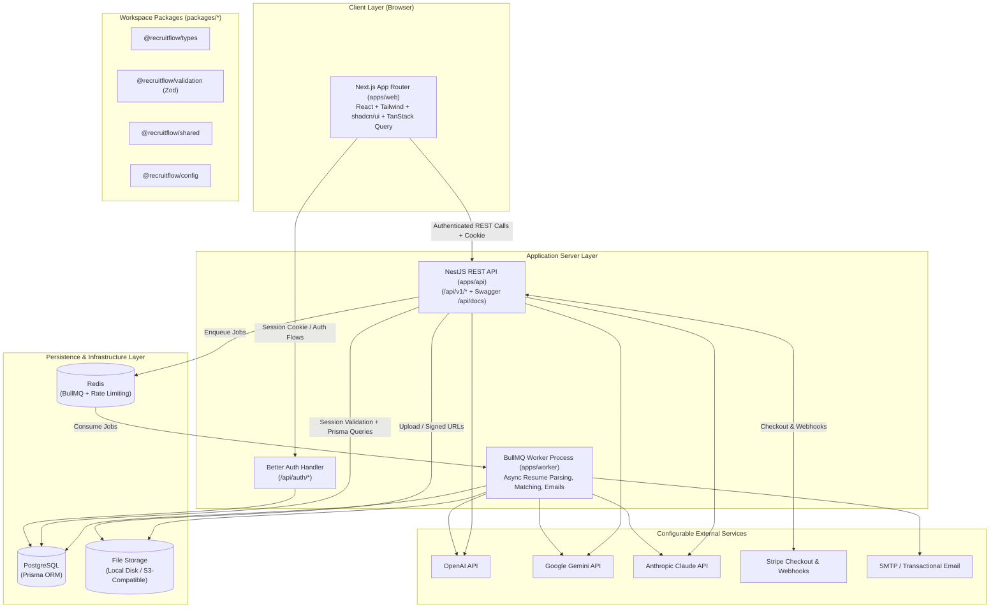
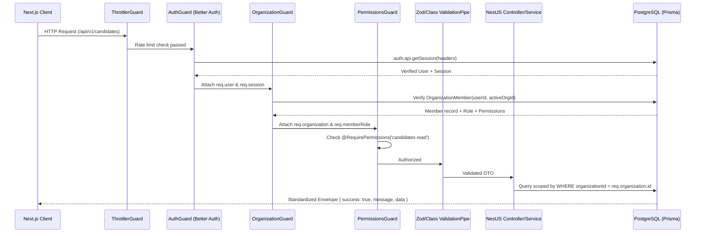

# RecruitFlow — System Architecture Specification

> **Document Version**: 1.0.0  
> **Product**: RecruitFlow — AI-Powered Recruitment Management System & ATS  
> **Target Distribution**: Self-Hosted Commercial SaaS / Enterprise ATS (CodeCanyon 2026)

---

## 1. Executive Summary & Architectural Goals

RecruitFlow is a multi-tenant, self-hostable AI-powered Applicant Tracking System (ATS) and Recruitment Management Platform built as a strict TypeScript monorepo. It is engineered so that any purchasing organization, recruitment agency, or software team can deploy, configure, customize, and operate the complete system on their own infrastructure without reliance on the original author's hosted services.

### Core Architectural Principles
1. **Strict Multi-Tenant Isolation**: Every business entity (Candidates, Jobs, Applications, Interviews, AI Usage, Subscriptions, Settings) is strictly scoped to an `organizationId`. Server-side guards resolve and verify active organization membership before any query executes.
2. **Single Source of Truth Authentication**: **Better Auth** (backed by PostgreSQL via Prisma) owns user identity, sessions, accounts, email verifications, and organization invitations. NestJS verifies sessions directly against Better Auth's server API / session store without introducing a duplicate JWT auth stack.
3. **Provider-Agnostic AI Engine**: Business modules never call OpenAI, Google Gemini, or Anthropic SDKs directly. All AI operations pass through a unified `AIProviderInterface` and `AIFactory` with structured Zod schema validation, timeout/retry policies, cost/token usage logging, and graceful fallback states when no API key is configured.
4. **Decoupled Asynchronous Processing**: Long-running tasks (PDF/DOCX resume text extraction & AI parsing, batch candidate matching, transactional emails, webhook processing) run in a dedicated BullMQ worker process (`apps/worker`) backed by Redis.
5. **Self-Hosted First**: Works out-of-the-box with local filesystem storage, optional SMTP, optional AI provider keys, and a built-in Free/Self-Hosted subscription tier when Stripe is not configured.

---

## 2. High-Level System Topology



---

## 3. Monorepo Structure & Package Boundaries

RecruitFlow uses a `pnpm` workspace monorepo layout:

| Workspace Path | Package Name | Responsibility |
| :--- | :--- | :--- |
| `apps/web` | `@recruitflow/web` | Next.js App Router frontend, marketing site, auth screens, multi-tenant dashboard, Kanban pipeline, Super Admin console |
| `apps/api` | `@recruitflow/api` | NestJS REST API (`/api/v1/*`), Better Auth verification guard, RBAC & Organization guards, business modules, Swagger docs |
| `apps/worker` | `@recruitflow/worker` | Standalone Node.js / NestJS BullMQ worker consuming `resume-parse`, `candidate-match`, `email-dispatch`, and `webhook-process` queues |
| `packages/types` | `@recruitflow/types` | Shared TypeScript interfaces, DTO shapes, API response envelopes, RBAC permission enums, AI structured output types |
| `packages/validation` | `@recruitflow/validation` | Shared Zod schemas used by both React Hook Form (`apps/web`) and NestJS validation pipes (`apps/api`) |
| `packages/shared` | `@recruitflow/shared` | Pure utility functions, constants, currency/date formatters, permission matrix helpers, slug generators |
| `packages/config` | `@recruitflow/config` | Shared TypeScript (`tsconfig`), ESLint, and Prettier configurations |
| `prisma/` | Root Prisma Schema | Canonical `schema.prisma`, version-controlled SQL migrations, and deterministic demo `seed.ts` |

---

## 4. Authentication & Cross-Boundary Session Verification (Better Auth)

### 4.1 Single Source of Truth
Better Auth is configured with the Prisma adapter connected to PostgreSQL and uses the official `organization` and `twoFactor` plugins.

### 4.2 How NestJS Verifies Sessions Without a Separate Auth System
1. **Shared Better Auth Instance / Configuration**: Better Auth is mounted at `/api/auth/*` and uses HTTP-only, `SameSite=Lax` (or `Strict`/`None` with `Secure` in production) signed session cookies (`better-auth.session_token`).
2. **NestJS `AuthGuard` (`apps/api/src/modules/auth/auth.guard.ts`)**:
   - Extracts incoming request headers (`cookie` and `authorization`).
   - Calls `auth.api.getSession({ headers: fromNodeHeaders(request.headers) })` from the shared Better Auth server configuration (or queries the verified Better Auth session & user record).
   - Verifies that `session` is present, not expired (`expiresAt > now()`), and that `user.isActive === true` and `user.deletedAt === null`.
   - Attaches the verified `{ user, session }` payload to `request.user` and `request.session`.
3. **Never Trust Client-Supplied Identity**:
   - `userId`, `role`, and `organizationId` sent in request bodies or query strings are ignored for authorization decisions.
   - Active organization context is resolved from `session.activeOrganizationId` (managed by Better Auth's organization plugin) or a validated `X-Organization-Id` header that is verified against the `OrganizationMember` table in `OrganizationGuard`.

---

## 5. Multi-Tenant Security & Guard Pipeline

Every protected endpoint in `apps/api` executes a strict, deterministic guard and interceptor pipeline:



### Guard Responsibilities
1. **`ThrottlerGuard`**: Protects auth endpoints, AI endpoints, and public application forms from brute-force or abuse.
2. **`AuthGuard`**: Validates the Better Auth session and checks user account status.
3. **`SuperAdminGuard`**: Checks `req.user.isSuperAdmin === true` for `/api/v1/admin/*` endpoints.
4. **`OrganizationGuard`**: Resolves the active organization, verifies that the organization is active, and confirms the authenticated user has an active `OrganizationMember` record in that organization.
5. **`PermissionsGuard`**: Evaluates the `@RequirePermissions(...)` metadata against the member's assigned role permissions.

---

## 6. Provider-Agnostic AI Architecture

```
apps/api/src/modules/ai/
├── providers/
│   ├── ai-provider.interface.ts
│   ├── openai.provider.ts
│   ├── gemini.provider.ts
│   └── anthropic.provider.ts
├── modules/
│   ├── resume-parser/
│   ├── candidate-matching/
│   ├── job-description/
│   ├── interview-assistant/
│   └── email-assistant/
├── prompts/
├── schemas/
├── services/
│   ├── ai-config.service.ts
│   └── ai-usage.service.ts
├── ai.factory.ts
└── ai.module.ts
```

### Key Design Decisions
- **`AIProviderInterface`**: Defines `generateStructured<T>(options: StructuredGenerationOptions<T>): Promise<AIProviderResult<T>>` and `generateText(options: TextGenerationOptions): Promise<AIProviderResult<string>>`.
- **Configuration Hierarchy**: Checks Organization-level AI configuration first (if allowed by plan/admin settings), then falls back to Global Super Admin `AIProvider` table settings, then environment variables (`OPENAI_API_KEY`, `GEMINI_API_KEY`, `ANTHROPIC_API_KEY`).
- **Explicit Unconfigured State**: If no provider is enabled or no valid API key is present, the AI factory returns a typed `AIConfigurationError` (`AI_PROVIDER_NOT_CONFIGURED`). The UI displays a clear banner guiding the administrator to configure an API key—never fake or mocked AI responses in production flows.
- **Human-in-the-Loop Enforcement**:
  - **Resume Parser**: Stores parsed JSON in a staging field (`CandidateResume.extractedData`) with status `PENDING_REVIEW`. Only creates/updates `Candidate` fields when a recruiter explicitly approves or edits the extracted profile.
  - **Candidate Matching**: Excludes protected demographic attributes from prompts; returns transparent criteria scores (`matchingSkills`, `missingSkills`, `experienceAlignment`, `reasoning`) and never auto-rejects or auto-advances an application.

---

## 7. File Storage Architecture

RecruitFlow implements a `StorageProviderInterface` (`apps/api/src/providers/storage/`):
- **`LocalStorageProvider`**: Default for local development and single-server self-hosted deployments. Stores files outside the public web root (`./storage/uploads/<orgId>/...`) and serves them only through authenticated, permission-checked download streams or short-lived signed tokens.
- **`S3StorageProvider`**: Compatible with AWS S3, Cloudflare R2, MinIO, DigitalOcean Spaces, and Backblaze B2 using `@aws-sdk/client-s3` and `@aws-sdk/s3-request-presigner`.
- **Security Controls**:
  - Strict MIME-type and magic-byte validation (`application/pdf`, `application/vnd.openxmlformats-officedocument.wordprocessingml.document`, `image/png`, `image/jpeg`, `image/webp`).
  - Configurable maximum file size (default 10 MB for resumes, 2 MB for avatars/logos).
  - Randomized UUID storage keys (`<orgId>/resumes/<uuid>.pdf`) preventing path traversal (`../`) and filename collisions.

---

## 8. Subscription, Billing & Self-Hosted Mode

- **Built-in Plans**: Seeded with `Free / Self-Hosted`, `Starter`, `Professional`, and `Enterprise` plans in `SubscriptionPlan`.
- **Self-Hosted Graceful Operation**: When `STRIPE_SECRET_KEY` is not set in `.env`, RecruitFlow automatically runs in **Self-Hosted Mode**, where Super Admins can assign any plan directly to organizations and billing checkout buttons clearly indicate self-managed licensing.
- **Stripe Integration**: When configured, supports Stripe Checkout sessions, Customer Portal, and verified webhook handling (`checkout.session.completed`, `customer.subscription.updated`, `customer.subscription.deleted`, `invoice.payment_succeeded`, `invoice.payment_failed`) using raw body signature verification (`stripe.webhooks.constructEvent`).

---

## 9. Integration Risk Matrix & Mitigations

| # | Identified Risk | Impact | Mitigation Strategy |
| :--- | :--- | :--- | :--- |
| 1 | **Cross-Origin Cookie Sharing between Next.js (`:3000`) and NestJS (`:4000`)** | High | Configure Next.js rewrite proxy (`/api/v1/*` -> NestJS) AND CORS with `credentials: true` + `BETTER_AUTH_TRUSTED_ORIGINS` so cookies work seamlessly in both proxied and direct API calls. |
| 2 | **Cross-Tenant Data Leakage (`organizationId` spoofing)** | Critical | Enforce `OrganizationGuard` on all tenant routes; require `organizationId` in every Prisma `where` clause; test with multi-org E2E test suite. |
| 3 | **Malformed or Hallucinated JSON from AI Providers** | High | Validate every AI response through strict Zod schemas (`packages/validation`) before saving; retry once with schema error feedback on parse failure; record failed runs in `AIUsageLog`. |
| 4 | **Candidate vs. Application State Confusion** | High | Keep `Candidate` as the organization-scoped person profile and `JobApplication` as the job-specific state machine (`NEW` -> `HIRED`/`REJECTED`) with an immutable `resumeId` snapshot per application. |
| 5 | **Corrupt or Malicious PDF/DOCX Uploads** | Medium | Validate magic bytes, enforce size limits via Multer limits, extract text in isolated try/catch blocks inside BullMQ worker with timeout protection. |
| 6 | **Stripe Webhook Replay or Forgery** | High | Preserve raw request buffer on `/api/v1/subscriptions/webhook`, verify `Stripe-Signature`, and track processed Stripe event IDs for idempotency. |

