# RecruitFlow — Database Design & Relational Schema Specification

> **Document Version**: 1.0.0  
> **Database Engine**: PostgreSQL 15+  
> **ORM**: Prisma ORM  
> **Schema Location**: `prisma/schema.prisma`

---

## 1. Design Philosophy

RecruitFlow's PostgreSQL schema is designed around four non-negotiable guarantees:
1. **Better Auth Native Compatibility**: Authentication and organization core tables (`User`, `Session`, `Account`, `Verification`, `Organization`, `OrganizationMember`, `Invitation`) adhere to Better Auth's official Prisma schema conventions while extending with RecruitFlow business fields.
2. **Strict Multi-Tenant Isolation**: Every tenant-owned table carries an indexed `organizationId` foreign key referencing `Organization(id)` with `ON DELETE CASCADE` (or `RESTRICT` for financial audit records).
3. **Separation of Candidate Profile vs. Job Application Lifecycle**: A `Candidate` belongs to an `Organization` and can apply to multiple `Job` records via `JobApplication`. Updating the stage or notes on one `JobApplication` never mutates another `JobApplication` for the same candidate. Each `JobApplication` snapshots the `CandidateResume` version submitted at application time.
4. **Auditability & Soft Deletion**: Core business records (`Candidate`, `Job`, `JobApplication`) support soft deletion (`deletedAt DateTime?`) alongside immutable history logs (`ApplicationStatusHistory`, `ActivityLog`, `AIUsageLog`).

---

## 2. Entity-Relationship Diagram (ERD)

```mermaid
erDiagram
    User ||--o{ Session : "has"
    User ||--o{ Account : "has"
    User ||--o{ OrganizationMember : "memberships"
    Organization ||--o{ OrganizationMember : "members"
    Organization ||--o{ Invitation : "invitations"
    Organization ||--o| OrganizationSettings : "settings"
    Organization ||--o{ Role : "custom/system roles"
    Role ||--o{ RolePermission : "grants"
    Permission ||--o{ RolePermission : "included in"
    Role ||--o{ OrganizationMember : "assigned to"

    Organization ||--o{ Candidate : "owns"
    Candidate ||--o{ CandidateSkill : "skills"
    Candidate ||--o{ CandidateEducation : "education"
    Candidate ||--o{ CandidateExperience : "experience"
    Candidate ||--o{ CandidateCertification : "certifications"
    Candidate ||--o{ CandidateResume : "resumes"
    Candidate ||--o{ CandidateNote : "notes"
    Candidate ||--o{ CandidateAttachment : "attachments"

    Organization ||--o{ Job : "publishes"
    Job ||--o{ JobSkill : "requires/prefers"
    Job ||--o{ JobApplication : "receives"
    Candidate ||--o{ JobApplication : "submits"
    CandidateResume ||--o{ JobApplication : "snapshot for"

    JobApplication ||--o{ ApplicationStatusHistory : "tracks stages"
    JobApplication ||--o{ ApplicationNote : "notes"
    JobApplication ||--o{ AICandidateMatch : "AI evaluations"
    JobApplication ||--o{ Interview : "interviews"

    Interview ||--o{ InterviewParticipant : "panel"
    Interview ||--o{ InterviewFeedback : "scorecards"
    User ||--o{ InterviewParticipant : "participates"
    User ||--o{ InterviewFeedback : "submits"

    Organization ||--o{ Notification : "scopes"
    User ||--o{ Notification : "receives"
    Organization ||--o{ ActivityLog : "audits"
    Organization ||--o{ AIProvider : "custom AI config"
    Organization ||--o{ AIUsageLog : "tracks tokens"
    SubscriptionPlan ||--o{ Subscription : "defines tier"
    Organization ||--o| Subscription : "active plan"
    Subscription ||--o{ Payment : "billing history"
```

---

## 3. Model Catalog (32 Models)

### 3.1 Identity, Authentication & Multi-Tenancy (Better Auth Compatible)
| Model | Table Name | Purpose | Key Constraints & Indexes |
| :--- | :--- | :--- | :--- |
| `User` | `users` | Platform user account (Recruiters, Hiring Managers, Interviewers, Org Admins, Super Admins) | `@unique([email])`, `isSuperAdmin`, `isActive`, `twoFactorEnabled` |
| `Session` | `sessions` | Better Auth active user session with `activeOrganizationId` | `@unique([token])`, `@@index([userId])`, `@@index([expiresAt])` |
| `Account` | `accounts` | Credential (password hash) and OAuth provider accounts | `@unique([providerId, accountId])`, `@@index([userId])` |
| `Verification` | `verifications` | Email verification and password reset tokens | `@@index([identifier])` |
| `TwoFactor` | `two_factors` | TOTP secret and backup codes for Better Auth 2FA plugin | `@@index([userId])` |
| `Organization` | `organizations` | Multi-tenant workspace (company, agency, or department) | `@unique([slug])`, `isActive` |
| `OrganizationMember` | `organization_members` | Links `User` to `Organization` with role assignment | `@@unique([organizationId, userId])`, `@@index([userId])` |
| `Invitation` | `invitations` | Pending/accepted/rejected email invitations to an organization | `@@index([organizationId, email])`, `@@index([status])` |
| `OrganizationSettings` | `organization_settings` | Per-organization timezone, branding, default pipeline stages, email preferences, AI toggles | `@unique([organizationId])` |

### 3.2 Role-Based Access Control (RBAC)
| Model | Table Name | Purpose | Key Constraints & Indexes |
| :--- | :--- | :--- | :--- |
| `Role` | `roles` | System (`ORG_ADMIN`, `HIRING_MANAGER`, `RECRUITER`, `INTERVIEWER`) and custom roles | `@@unique([organizationId, slug])` |
| `Permission` | `permissions` | Atomic permission catalog (`candidates.read`, `jobs.create`, etc.) | `@unique([code])` |
| `RolePermission` | `role_permissions` | Many-to-many junction mapping `Role` to `Permission` | `@@unique([roleId, permissionId])` |

### 3.3 Candidate Management
| Model | Table Name | Purpose | Key Constraints & Indexes |
| :--- | :--- | :--- | :--- |
| `Candidate` | `candidates` | Master candidate record within an organization | `@@unique([organizationId, email])`, `@@index([organizationId, createdAt])`, `deletedAt` |
| `CandidateSkill` | `candidate_skills` | Normalized skill tags with proficiency & years of experience | `@@unique([candidateId, name])` |
| `CandidateEducation` | `candidate_educations` | Academic degrees, institutions, graduation dates, GPA | `@@index([candidateId])` |
| `CandidateExperience` | `candidate_experiences` | Employment history, titles, companies, dates, achievements | `@@index([candidateId])` |
| `CandidateCertification`| `candidate_certifications`| Professional licenses and certifications | `@@index([candidateId])` |
| `CandidateResume` | `candidate_resumes` | Uploaded PDF/DOCX resume versions, extracted raw text, and AI parsed JSON staging | `@@index([candidateId, isPrimary])`, `parseStatus` |
| `CandidateNote` | `candidate_notes` | General recruiter notes on a candidate profile | `@@index([candidateId, createdAt])` |
| `CandidateAttachment` | `candidate_attachments` | Portfolio files, cover letters, certificates | `@@index([candidateId])` |

### 3.4 Job Management
| Model | Table Name | Purpose | Key Constraints & Indexes |
| :--- | :--- | :--- | :--- |
| `Job` | `jobs` | Job requisition, description, salary band, status, pipeline configuration | `@@unique([organizationId, slug])`, `@@index([organizationId, status])`, `deletedAt` |
| `JobSkill` | `job_skills` | Required and preferred skills for a job (`isRequired: Boolean`, `weight: Int`) | `@@unique([jobId, name])` |

### 3.5 Application Pipeline & Lifecycle
| Model | Table Name | Purpose | Key Constraints & Indexes |
| :--- | :--- | :--- | :--- |
| `JobApplication` | `job_applications` | Links a `Candidate` to a `Job` with independent status, stage order, assigned recruiter, and snapshot `resumeId` | `@@unique([jobId, candidateId])`, `@@index([organizationId, status])` |
| `ApplicationStatusHistory` | `application_status_histories` | Immutable audit trail of every status transition (`fromStatus`, `toStatus`, `changedById`, `reason`) | `@@index([applicationId, createdAt])` |
| `ApplicationNote` | `application_notes` | Stage-specific or application-specific recruiter collaboration notes | `@@index([applicationId, createdAt])` |
| `AICandidateMatch` | `ai_candidate_matches` | Explainable AI match evaluation between a `Candidate` and a `Job` | `@@unique([applicationId])`, `@@index([jobId, overallScore])` |

### 3.6 Interview Scheduling & Scorecards
| Model | Table Name | Purpose | Key Constraints & Indexes |
| :--- | :--- | :--- | :--- |
| `Interview` | `interviews` | Scheduled interview event with start/end time, timezone, type (`VIDEO`, `PHONE`, `ONSITE`, `TECHNICAL`), meeting link, and status | `@@index([organizationId, scheduledAt])`, `@@index([applicationId])` |
| `InterviewParticipant` | `interview_participants` | Assigns interviewers (`User`) to an `Interview` with role & RSVP status | `@@unique([interviewId, userId])` |
| `InterviewFeedback` | `interview_feedbacks` | Structured scorecard, criteria ratings (1–5), pros/cons, recommendation (`STRONG_HIRE`, `HIRE`, `NO_HIRE`, `STRONG_NO_HIRE`) | `@@unique([interviewId, reviewerId])` |

### 3.7 AI Engine, Notifications, Audit & Billing
| Model | Table Name | Purpose | Key Constraints & Indexes |
| :--- | :--- | :--- | :--- |
| `AIProvider` | `ai_providers` | Global or organization-level AI provider configurations (`OPENAI`, `GEMINI`, `ANTHROPIC`), encrypted API key reference, default model, active status | `@@index([organizationId, provider])` |
| `AIUsageLog` | `ai_usage_logs` | Token usage (`promptTokens`, `completionTokens`, `totalTokens`), latency, feature type, cost estimate, and status | `@@index([organizationId, createdAt])`, `@@index([feature])` |
| `Notification` | `notifications` | In-app and email notification queue/records per user | `@@index([userId, isRead, createdAt])` |
| `ActivityLog` | `activity_logs` | Organization and Super Admin audit log (`entityType`, `entityId`, `action`, `metadata`, `ipAddress`) | `@@index([organizationId, createdAt])` |
| `SubscriptionPlan` | `subscription_plans` | Commercial plan definitions (`code`, `name`, `priceMonthly`, `priceYearly`, `maxJobs`, `maxCandidates`, `maxMembers`, `aiCreditsMonthly`) | `@unique([code])` |
| `Subscription` | `subscriptions` | Organization's active subscription, billing cycle, Stripe customer/subscription IDs, and current usage counters | `@unique([organizationId])`, `@unique([stripeSubscriptionId])` |
| `Payment` | `payments` | Invoice and payment transaction history | `@@index([organizationId, createdAt])`, `@unique([stripePaymentIntentId])` |

---

## 4. Transactional Integrity Rules

The following operations **must** execute inside `prisma.$transaction(...)`:
1. **Organization Creation**: Create `Organization` + `OrganizationSettings` + default RBAC `Role` mappings + `OrganizationMember` (Owner/`ORG_ADMIN`) + default `Subscription` (`FREE` tier) + `ActivityLog`.
2. **Application Stage Transition**: Update `JobApplication.status` + insert `ApplicationStatusHistory` + insert `ActivityLog` + enqueue candidate/team `Notification`.
3. **Approved AI Resume Import**: Update `Candidate` core fields + replace/upsert `CandidateSkill`, `CandidateEducation`, `CandidateExperience`, `CandidateCertification` + update `CandidateResume.parseStatus = 'APPROVED'` + insert `ActivityLog`.
4. **Interview Scheduling**: Create `Interview` + bulk insert `InterviewParticipant` records + insert `ApplicationStatusHistory` (if auto-moving to `INTERVIEW`) + create `Notification` entries.
5. **Stripe Webhook Subscription Update**: Update `Subscription` status/period + insert `Payment` record + update `ActivityLog`.

